# 1-10月中国汽车出口974万辆增49%，全年预计1200万辆

- 公開日時: 2026-11-26 12:41（北京時間）
- 出典: [搜狐号・崔东树](https://www.sohu.com/a/1106645613_115312)
- テーマ（自動判定）: 輸出
- 画像: 38枚

---

注：本分析文章仅代表崔东树个人观点，如有异议，请留言。

2026年1-10月中国汽车实现出口974万辆，同比2025年同期增速49%，10月中国汽车实现出口111万辆，同比增34%，环比下降6%，总体走势总体较强。今年的主要动力仍是高油价和中国产品竞争力提升和全球南方国家市场的持续增长。从结构看，乘用车出口占比逐步稳定，到2023年达到85%，随后相对稳定到87%。

2026年10月中国汽车出口总量的前10国家：俄罗斯89002辆、巴西63463辆、墨西哥59462辆、比利时58752辆、英国55349辆、澳大利亚44003辆、泰国31535辆、菲律宾29378辆、哈萨克斯坦25473辆、意大利24545辆，其中本期较同期增量增大的前五个是：比利时28609辆、巴西25718辆、英国23620辆、荷兰19118辆、澳大利亚15113辆。2026年1-10月累计整车出口总量的前10国家：俄罗斯841604辆、巴西603138辆、英国479522辆、比利时426631辆、墨西哥420980辆、澳大利亚417677辆、意大利270381辆、菲律宾265311辆、阿联酋255826辆、泰国255656辆，其中本期较同期增量增大的前五个是：俄罗斯390322辆、巴西347245辆、英国223202辆、澳大利亚165411辆、比利时162734辆。

俄罗斯市场中国车企防风险意识提升，2025年俄罗斯国内销量下滑不大，但我们出口去库存力度很大。2026年1-10月我们对俄罗斯的出口恢复较大。

2026年10月中国新能源汽车出口58.2万辆，同比增长77%；1-10月累计出口465万台，增75%的表现很好，10月新能源车出口环比9月下降5%。2026年10月中国汽车出口新能源渗透率53%，其中纯电动占比32%（同比+6%），插混占比21%（同比+7%），混动占比8%（同比+2%），纯汽油车占比31%（同比-13%）。2026年1-10月中国汽车出口新能源渗透率48%，其中纯电动占比30%（同比+2%），插混占比18%（同比+5%），混动占比7%（同比+1%），纯汽油车占比35%（同比-7%）。

2026年10月中国新能源汽车出口总量的前10国家：比利时55827辆、巴西40438辆、英国38995辆、澳大利亚33406辆、泰国30942辆、菲律宾26437辆、德国20122辆、荷兰19178辆、印度尼西亚18523辆、西班牙16787辆，其中本期较同期增量增大的前五个是：比利时27920辆、澳大利亚18399辆、巴西18162辆、英国16978辆、荷兰16579辆。

2026年1-10月中国新能源汽车出口总量的前10国家：巴西419672辆、比利时406859辆、英国352633辆、澳大利亚303983辆、泰国244397辆、菲律宾231634辆、德国162504辆、意大利148467辆、西班牙147907辆、韩国140164辆，其中本期较同期增量增大的前五个是：巴西256079辆、澳大利亚179861辆、英国177351辆、比利时155420辆、泰国132089辆。

中国客车2025年的全年海关出口达到10.6万辆（同期厂家出口12.60万台），海关出口占比83%。2026年1-10月海关出口达到10.5万台（厂家出口15.2万台），海关出口占比69%。海外散件出口组装规模增大，乃至尼泊尔竟然是新能源客车出口的第一大国。

一、中国汽车出口总体走势

1、汽车出口历年走势

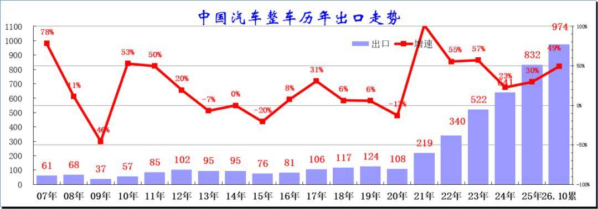

中国汽车出口历经多年百万量级的平台期后，于2021年实现突破。在2013 - 2016年世界经济低迷的大环境下，汽车出口出现剧烈下滑。2017 - 2020年，出口增速逐步企稳并有所改善，年度出口量维持在100万辆左右的水平。2020年出口量达到108万辆，同比下降13%，随后进入2021年以来的高增长期。

中国汽车出口自2021年突破百万量级后持续高增长（2021年增102%，2022-2023年增50%+，2024-2025年增速回落至30%左右），2026年1-10月出口974万辆（同比2025年增49%），延续增长态势。近期中国汽车出口呈现超高速增长态势，未来只要国际市场环境稳定，中国汽车出口发展仍具有巨大空间。

2、整车出口月度走势

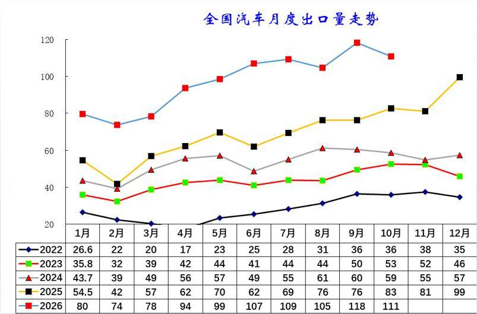

从月度走势看，近几年的中国汽车出口仍呈现惯性持续走强特征，近期呈现出口走高与国内低迷反差走势特征。2026年1-10月出口增速相对很强，延续持续增长动力。虽然有美伊战争的爆发，但由于市场分散，中国汽车出口增速受外部环境影响较小，2026年以来持续拉升。

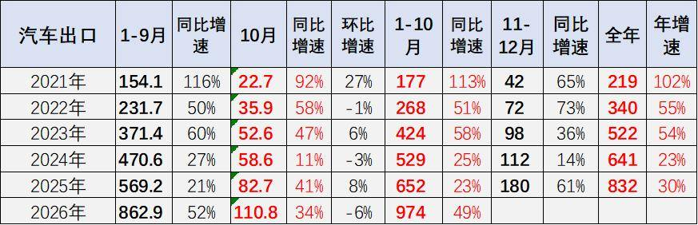

2026年1-10月中国汽车实现出口974万辆，同比2025年同期增速49%，10月中国汽车实现出口111万辆，同比增34%，环比下降6%，总体走势总体较强。今年的主要动力仍是高油价和中国产品竞争力提升及全球南方国家市场的持续增长。

从月度走势来看，近几年的中国汽车出口仍呈现出季节性特征，有夏季走高与国内反差的走势特点。2026年1-10月出口增速相对强劲，主要也是国内市场低迷，企业对应海外市场动力和能力增强。

3、汽车整车出口结构特征

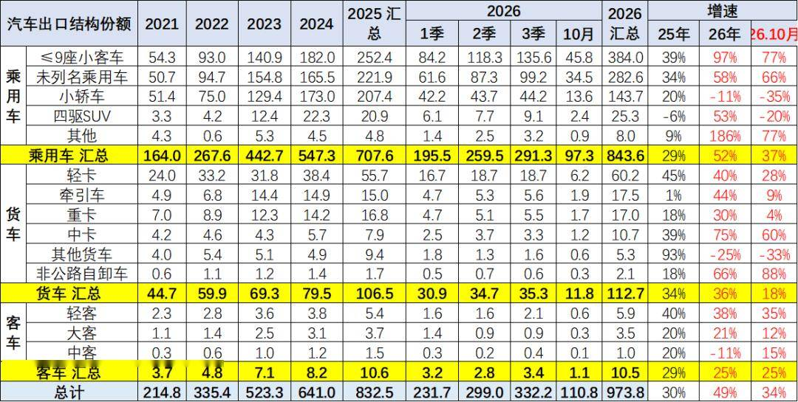

2020年前的中国汽车出口维持在百万规模，随后持续高速增长到2025年的833万辆。乘用车出口持续走强，货车和客车出口也持续较好增长。

今年全年海关各类车型增速分化，乘用车出口增速逐步回升到52%，客车出口增长25%，货车出口增长36%，货车的增速慢于乘用车，相对于国内的燃油货车平稳走势，近期电动货车出口较好。

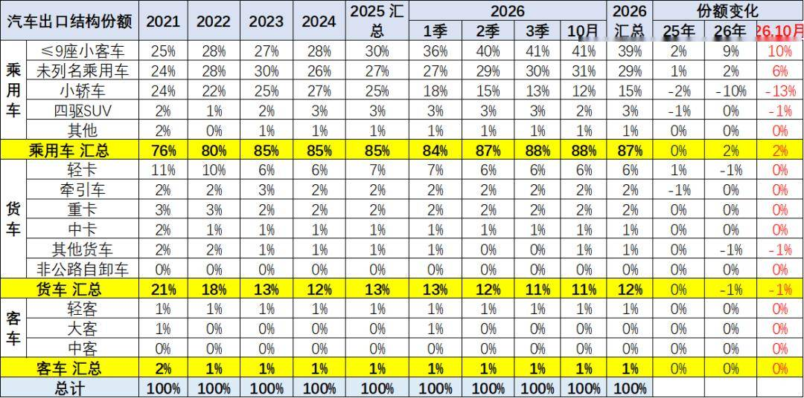

从结构看，乘用车出口占比逐步稳定，到2023年达到85%，随后相对稳定到87%。货车出口因电动卡车而小幅提升。近几年客车的出口占比持续回落到较低水平。由于乘用车是贸易焦点，出口的货车和客车比例总体达到13%，稍低于国内的商用车占比。

乘用车内部的几类主力车型表现较均衡，2026年乘用车出口表现较强的是9座以下小客车，2026年9座以下客车占比39%，其中10月达到41%。虽然特斯拉出口回落的影响较大，低速车车口放缓，但10月自主的电动车出口增长较好。

货车10月份额表现较差。皮卡10月增长提升，重卡出口表现高位回落，其它卡车市场走势较强。客车中的大中型客车表现偏弱，轻型客车出口占比10月回升。

4、出口动力结构特征

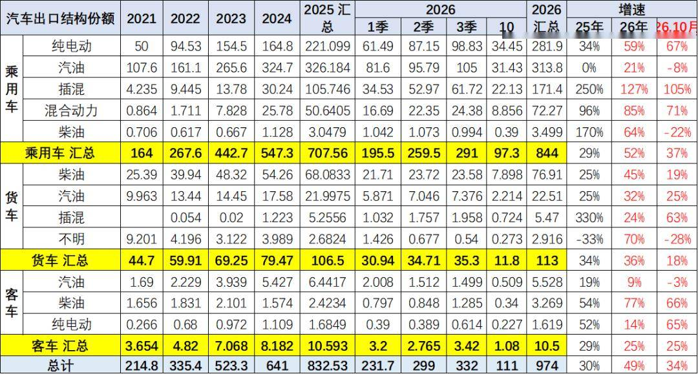

出口动力结构特征方面，2025年乘用车的出口增速回落较大，其中汽油车的出口均增速偏低，今年混合动力乘用车的出口很强，而插混的乘用车出口增速最强。今年货车和客车出口平稳，乘用车出口俄罗斯和欧洲的暴增是核心增长推动。

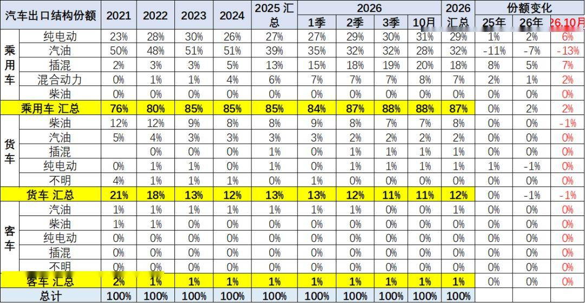

2026年1-10月乘用车的新能源的占比回升，燃油车占比下降明显，混合动力异军突起。汽油乘用车和柴油货车、汽油客车出口下降较大。10月的插混乘用车、纯电动乘用车和混动乘用车出口较好增长。

二、汽车出口市场格局

1、出口厂家国内区域特征

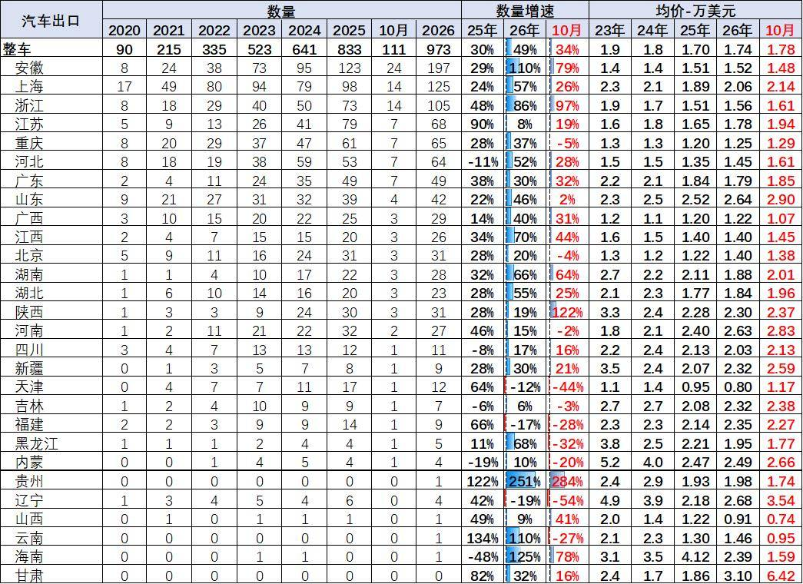

2024年开始上海出口的全国汽车龙头地位被安徽替代，2026年安徽仍保持出口第一的地位。上海对中国出口的重要意义极其明显，实际是长四角的龙头，辐射效应强。2026年1-10月安徽汽车出口增速110%，这主要是由于安徽本地的企业相对比较优秀，加之比亚迪等企业落户合肥。上海企业出口档次高，上汽乘用车和特斯拉两家企业，出口均价较高。

近两年安徽的出口表现相对较强，主要也是奇瑞和江淮的出口表现相对较强，但俄罗斯的市场波动巨大，因此近期安徽出口多元化较好。2026年的河北、山东、江西的汽车出口贡献度上升较大。

2、出口区域特征

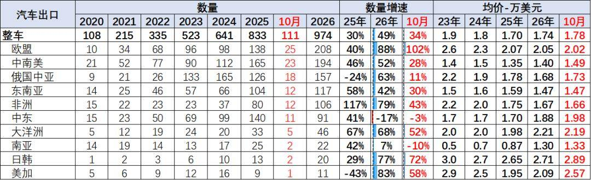

中国汽车出口总体表现较强，其中欧盟和非洲暴增，美加市场低基数高增长，针对日韩和非洲以及大洋洲的出口表现相对优秀。而针对东南亚地区、大洋洲出口表现压力较大。

前期的中国汽车出口在中南美洲和欧盟占比高，东南亚以及南亚等亚洲其它地区表现较强，目前逐步转到以中南美、欧洲、俄国中亚现相对较强的特征，日韩和美国出口也有改善。近期南亚低端市场相对低迷，尤其10月受到美伊战争影响，中东出口受阻明显。

3、整车出口分国别走势分析

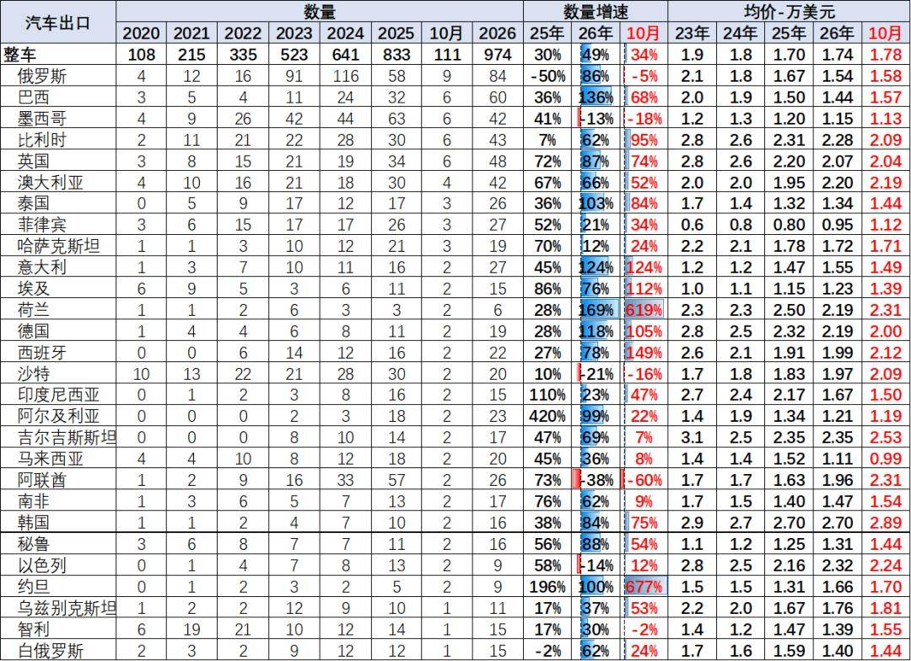

出口均价下降有利于出口增长，随着人民币升值，出口美元价格保持稳定，2026年中国汽车出口价格竞争力较强。前期俄罗斯市场巨变，其它外资退出，因此2023年以来中国对俄罗斯的出口也较多，2025年去库存，2026年回归正常状态。去年出口是对比利时的出口车较多，今年欧洲关系改善，出口表现也有改善。

10月我们对阿联酋市场出口下滑60%，其他中东国家萎缩也较严重。

近期的巴西市场表现较强，中国汽车走进入的本土化建厂取得一定成效。英国、泰国等车市今年有所恢复。

4、整车出口月度增减量走势

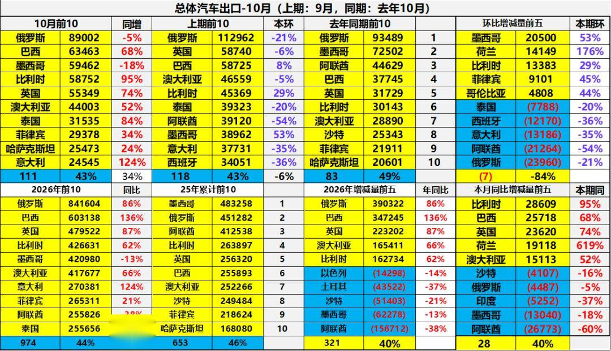

2026年10月中国汽车出口总量的前10国家：俄罗斯89002辆、巴西63463辆、墨西哥59462辆、比利时58752辆、英国55349辆、澳大利亚44003辆、泰国31535辆、菲律宾29378辆、哈萨克斯坦25473辆、意大利24545辆，其中本期较同期增量增大的前五个是：比利时28609辆、巴西25718辆、英国23620辆、荷兰19118辆、澳大利亚15113辆。

俄罗斯市场中国车企防风险意识提升，2025年俄罗斯国内销量下滑不大，但我们出口去库存力度很大。2026年1-10月我们对俄罗斯的出口恢复较大。

2026年1-10月累计整车出口总量的前10国家：俄罗斯841604辆、巴西603138辆、英国479522辆、比利时426631辆、墨西哥420980辆、澳大利亚417677辆、意大利270381辆、菲律宾265311辆、阿联酋255826辆、泰国255656辆，其中本期较同期增量增大的前五个是：俄罗斯390322辆、巴西347245辆、英国223202辆、澳大利亚165411辆、比利时162734辆。

5、历年出口主力国家变化分析

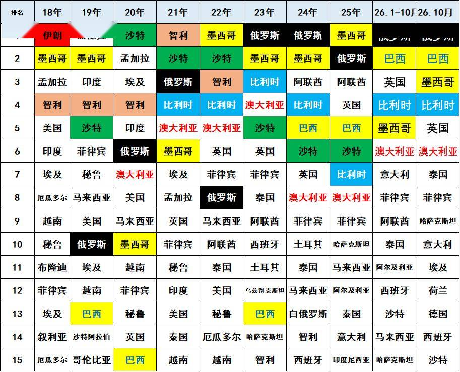

前期汽车出口的海外根据地效果并不理想，主力市场波动较大。2023 - 2024年汽车出口主要市场来自俄罗斯、墨西哥、比利时、澳大利亚、沙特、英国等国家，欧美市场走势较强。近期英国、澳大利亚等相对发达国家表现改善。

2026年1-10月汽车出口结构变化，俄罗斯回升到出口第一地位，英国市场增长很强，阿联酋的出口同比下降较大。10月对俄罗斯出口表现较好，主要是基数较低。

三、新能源车出口走势

1、历年新能源汽车整车出口特征

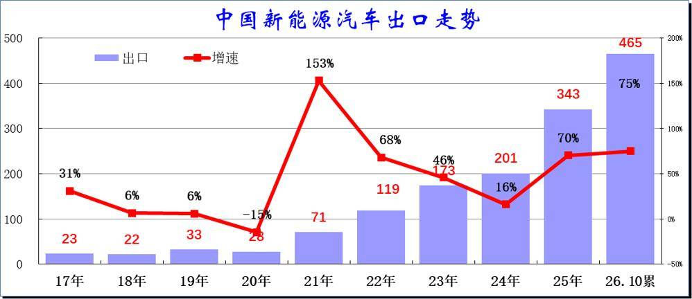

随着中国国内新能源车市场从补贴驱动向市场驱动的转型，中国新能源汽车的市场竞争力大幅增长。中国新能源汽车出口自2021年实现爆发增长，随后进入持续的高增长区间。虽然2024年受到欧盟出口新能源的政策干扰，但2024年全年中国新能源汽车出口仍达到201万辆，同比增长16%。2025年出口新能源车343万辆，同比增长70%，表现良好。2026年1-10月出口新能源车465万辆，同比增长75%，表现良好。

2、历年新能源汽车月度出口特征

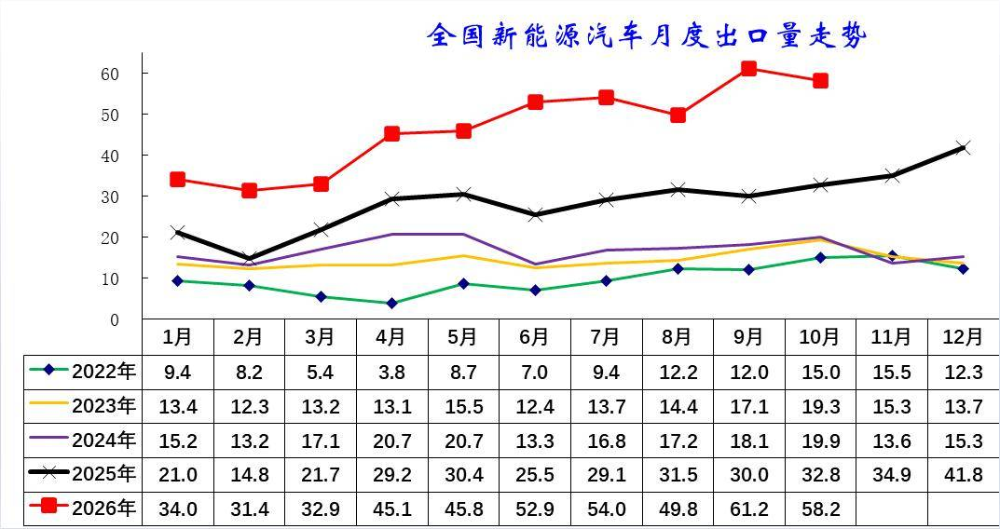

因欧盟加征关税，2024年下半年中国新能源出口走势低迷，市场压力较大。2025年3月开始的新能源车出口暴增的走势超强。2026年1-10月新能源出口持续历史高位，国内低迷推动出口热情更高。

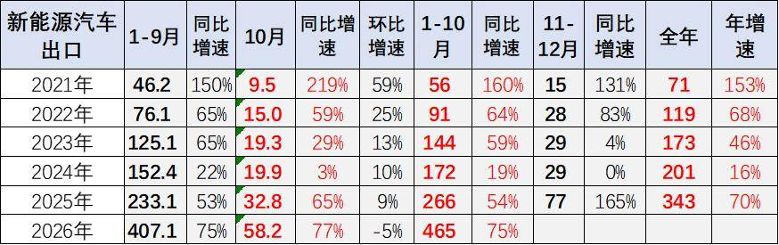

在连续高增长后，2024年全年新能源汽车累计出口量201万辆，同比增长16%。2025年全国新能源汽车出口量343万辆，同比增长70%，增速高于2024年全年的16%较多。2026年10月中国新能源汽车出口58.2万辆，同比增长77%；1-10月累计出口465万台，增75%的表现很好，10月新能源车出口环比9月下降5%。

3、汽车整车出口结构变化

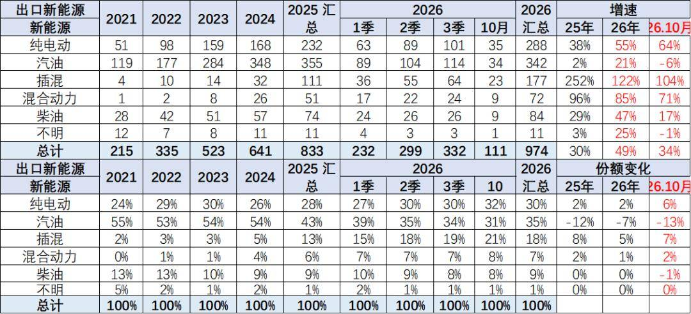

2026年10月中国汽车出口新能源渗透率53%，其中纯电动占比32%（同比+6%），插混占比21%（同比+7%），混动占比8%（同比+2%），纯汽油车占比31%（同比-13%）。

2026年1-10月中国汽车出口新能源渗透率48%，其中纯电动占比30%（同比+2%），插混占比18%（同比+5%），混动占比7%（同比+1%），纯汽油车占比35%（同比-7%）。

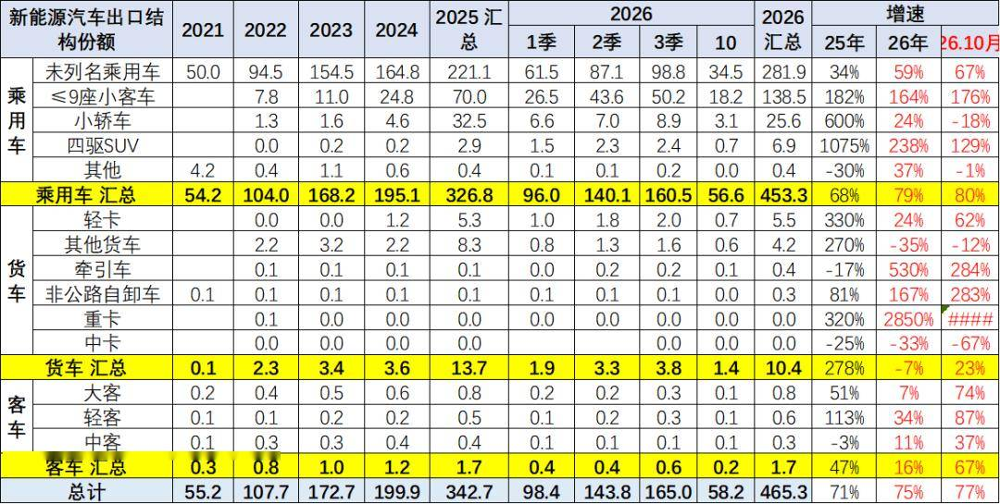

商用车出口竞争力很差，新能源车出口的98%都是乘用车，商用车占比较小。新能源货车表现好于客车。电动化导致的未列名乘用车占比保持高位。

4、新能源出口地区变化分析

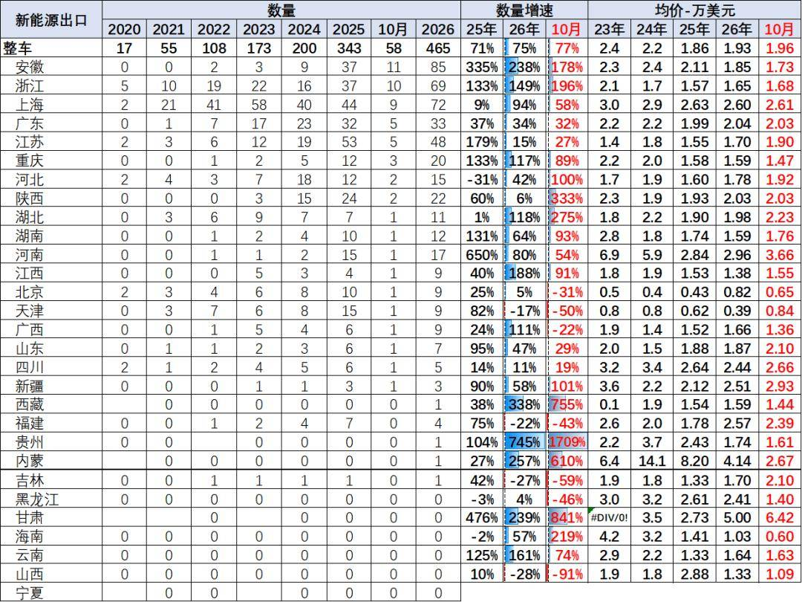

随着特斯拉进入中国，中国汽车出口格局改变，前几年上海长期第一。随着国产车崛起，自主成为新能源出口核心，近期安徽等崛起，10月安徽、浙江的新能源出口表现较好，江苏出口较差。

2026年新能源汽车出口均价相对稳定上升，出口表现较好。

5、历年新能源乘用车整车出口国家特征

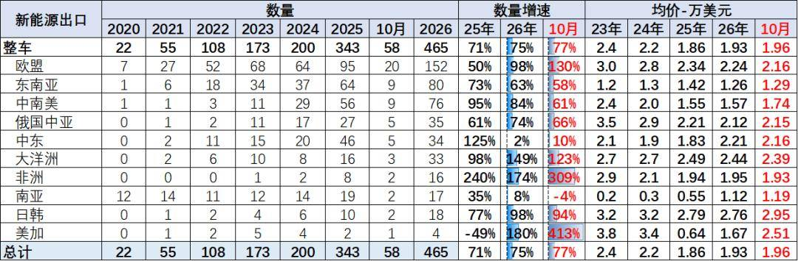

新能源车出口获得更多的突破，2026年仍是欧盟最强，非洲、美加和日韩增速表现较高，东南亚还相对平稳增长。

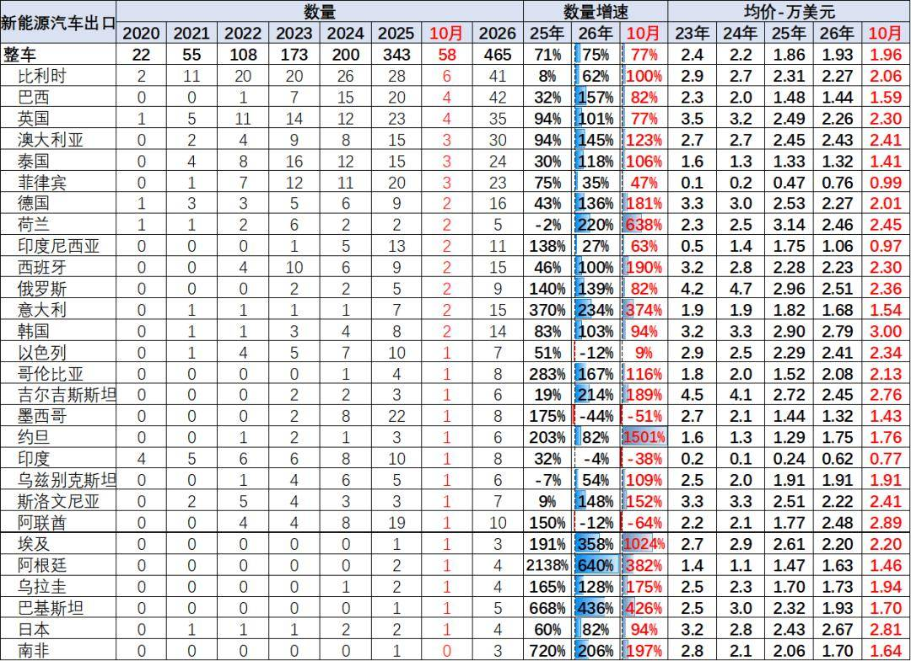

2026年新能源汽车出口同比增长分化。新能源汽车出口主要是欧洲、亚洲两大市场，今年10月的比利时超越巴西成为新能源车出口的第一大市场，巴西建厂推动巴西出口上半年暴增，3季度深度调整。10月的墨西哥新能源出口持续暴跌。

今年新能源车出口的主力市场基本都有较好增长。德国、意大利等市场新能源车出口增长表现突出，墨西哥市场走弱，泰国市场走势回暖。

6、2026年新能源汽车整车出口变化分析

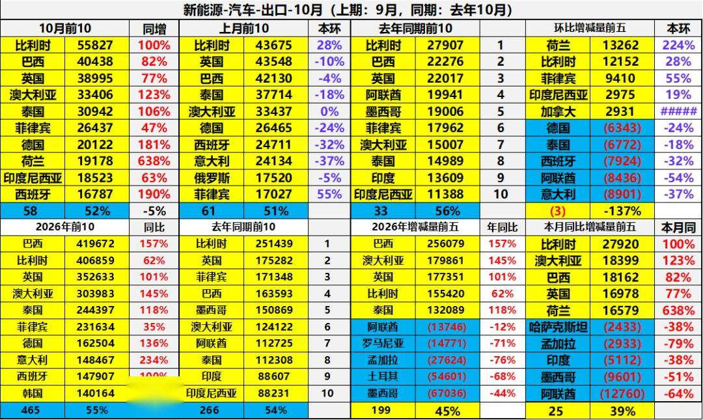

2026年10月中国新能源汽车出口总量的前10国家：比利时55827辆、巴西40438辆、英国38995辆、澳大利亚33406辆、泰国30942辆、菲律宾26437辆、德国20122辆、荷兰19178辆、印度尼西亚18523辆、西班牙16787辆，其中本期较同期增量增大的前五个是：比利时27920辆、澳大利亚18399辆、巴西18162辆、英国16978辆、荷兰16579辆。

2026年1-10月中国新能源汽车出口总量的前10国家：巴西419672辆、比利时406859辆、英国352633辆、澳大利亚303983辆、泰国244397辆、菲律宾231634辆、德国162504辆、意大利148467辆、西班牙147907辆、韩国140164辆，其中本期较同期增量增大的前五个是：巴西256079辆、澳大利亚179861辆、英国177351辆、比利时155420辆、泰国132089辆。

2026年出口巴西、比利时、英国等欧盟是几大主力方向。近期的土耳其、墨西哥等市场出口较弱。

7、燃油车分动力整车出口变化分析

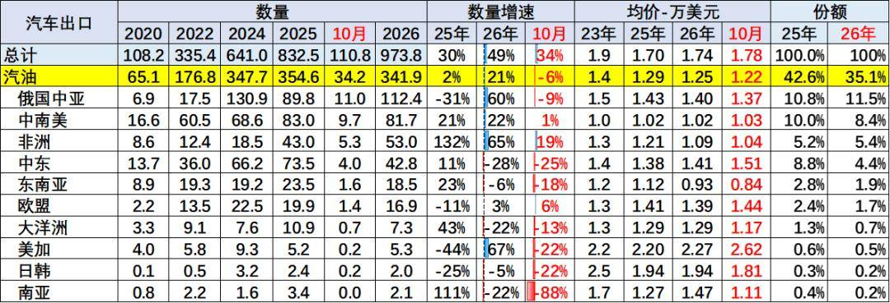

2024年全年中国汽油燃油车出口348万辆、增22%；2025年中国汽油燃油车出口355万辆、增2%；2026年1-10月中国汽油燃油车出口341.9万辆、增21%。

今年中国对俄罗斯、非洲等市场的燃油车市场较强，其它市场总体表现一般，尤其是欧盟、大洋洲等市场的燃油车出口下降，高质量发展特征明显。

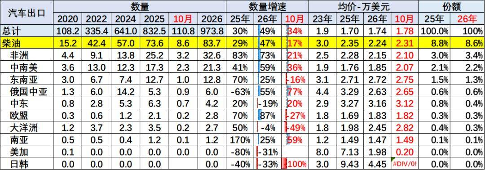

今年柴油车出口好于汽油车，实现柴油车在非洲、中南美的较强增长局面。10月的俄国中亚和南亚出口较好、日韩的出口表现较差。

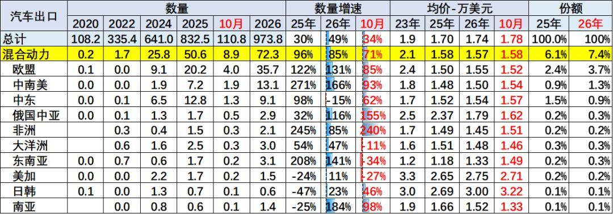

今年混合动力车型对欧洲和中南美、亚洲其它市场的增量超强，体现了中国乘用车竞争力的全面提升。但中东销量剧烈下滑，俄国中亚地区的混合动力表现一般。

8、2026年新能源汽车整车出口变化分析

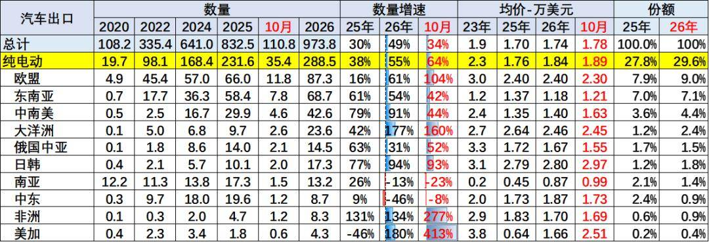

2024年全年中国纯电动车型出口168万辆、增6%；2025年中国纯电动车出口232万辆、增38%；2026年1-10月中国纯电动车出口289万辆、增55%，10月增长64%也是很好的。

目前纯电动的欧盟市场仍是绝对主力市场，东南亚市场和中南美等市场的需求相对波动较大，日韩市场上升明显，但中东市场损失巨大。由于国外基础设施缺乏，加之中国纯电动过于追求高端，大型化特征明显，小型电动车缺乏好产品，纯电动的出口仍有提升空间。

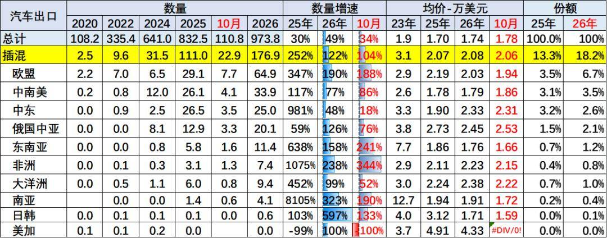

2026年1-10月中国插混车型出口177万辆、增122%，其中10月插混出口23万辆、增104%。除了美加等地区的插混需求很少，其它地区的中国插混表现都很突出。而欧盟地区的中国插混车型需求爆发增长，中东的插混出口总体算是增长。

四、乘用车分类别出口走势

1、乘用车分排量出口

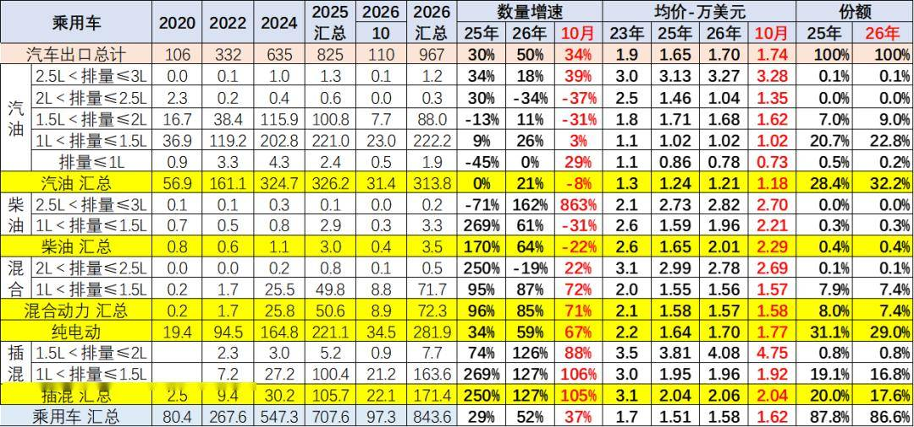

乘用车出口主要靠插混和混合动力乘用车，纯电动表现也很强，燃油车出口保持较好走势。燃油车的排量在1升-1.5升区间为主体，这也是中国自主乘用车的产品综合优势。2025年的1.5-2升车型下滑剧烈。今年1.5-2升车型出口恢复较快，说明俄罗斯等更需求中国的高端高价SUV车型，柴油乘用车基本没啥市场。

而电动车车型的产品档次分化，高端电动车出口改善较大，而入门级插混出口增长较好。

2、乘用车整车出口结构特征

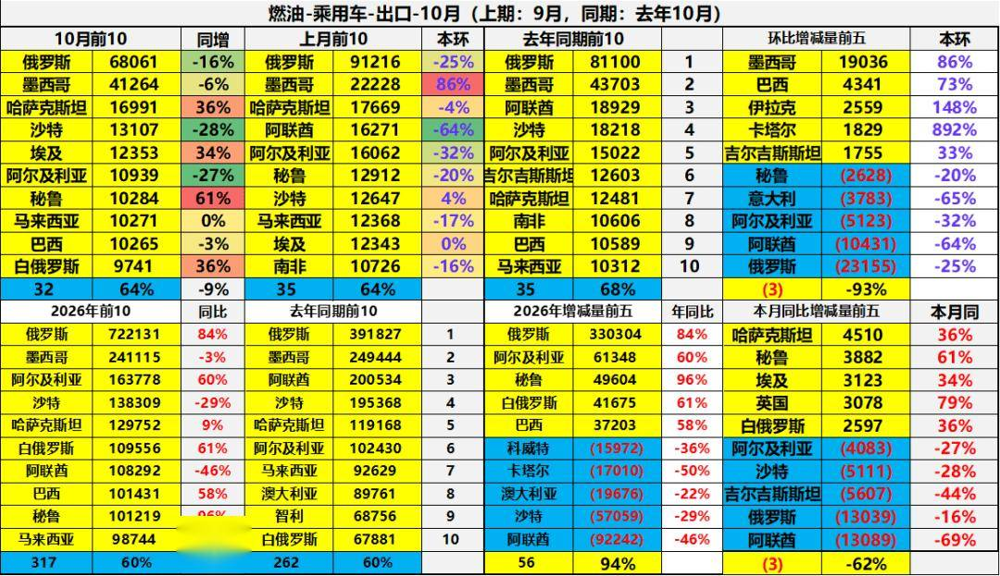

中国燃油乘用车2026年10月出口规模最多的是：俄罗斯68061辆、墨西哥41264辆、哈萨克斯坦16991辆、沙特13107辆、埃及12353辆、阿尔及利亚10939辆、秘鲁10284辆、马来西亚10271辆、巴西10265辆、白俄罗斯9741辆，其中本期较同期增量增大的前五个是：哈萨克斯坦4510辆、秘鲁3882辆、埃及3123辆、英国3078辆、白俄罗斯2597辆。

中国燃油乘用车2026年1-10月出口规模最多的是：俄罗斯722131辆、墨西哥241115辆、阿尔及利亚163778辆、沙特138309辆、哈萨克斯坦129752辆、白俄罗斯109556辆、阿联酋108292辆、巴西101431辆、秘鲁101219辆、马来西亚98744辆，其中今年较去年同期增量增大的前五个是：俄罗斯330304辆、阿尔及利亚61348辆、秘鲁49604辆、白俄罗斯41675辆、巴西37203辆。

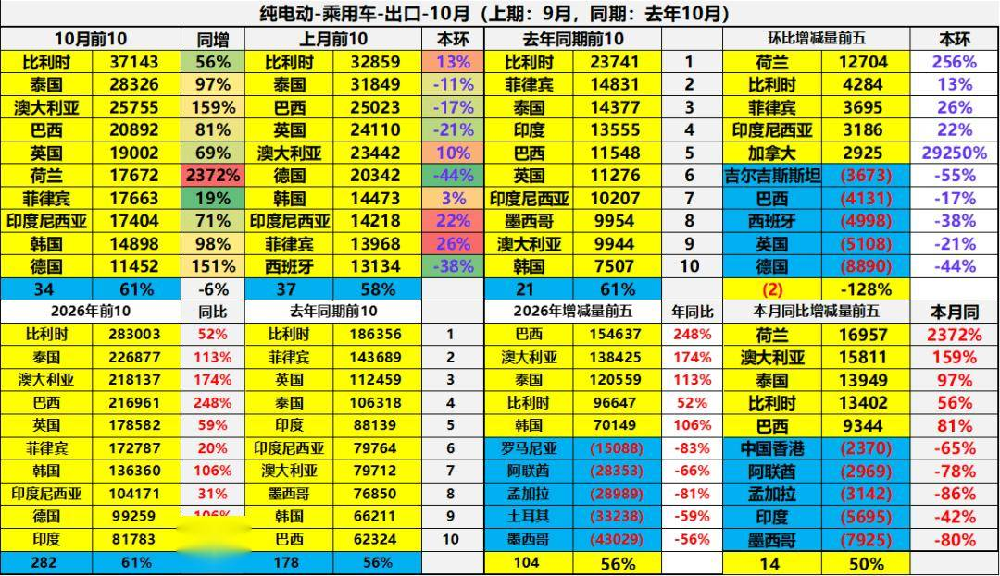

中国纯电动乘用车2026年10月出口主要是比利时37143辆、泰国28326辆、澳大利亚25755辆、巴西20892辆、英国19002辆、荷兰17672辆、菲律宾17663辆、印度尼西亚17404辆、韩国14898辆、德国11452辆，其中本期较同期增量增大的前五个是：荷兰16957辆、澳大利亚15811辆、泰国13949辆、比利时13402辆、巴西9344辆。

中国纯电动乘用车2026年1-10月出口主要是比利时283003辆、泰国226877辆、澳大利亚218137辆、巴西216961辆、英国178582辆、菲律宾172787辆、韩国136360辆、印度尼西亚104171辆、德国99259辆、印度81783辆，其中今年较去年同期增量增大的前五个是：巴西154637辆、澳大利亚138425辆、泰国120559辆、比利时96647辆、韩国70149辆。

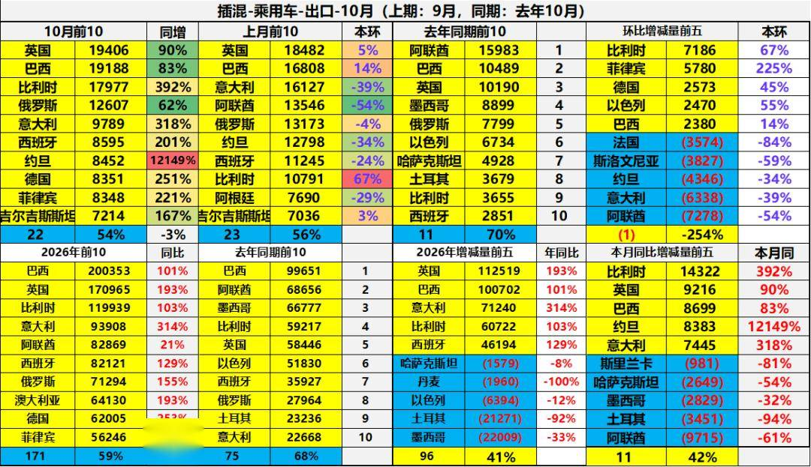

2026年10月出口插混乘用车的主要是：英国19406辆、巴西19188辆、比利时17977辆、俄罗斯12607辆、意大利9789辆、西班牙8595辆、约旦8452辆、德国8351辆、菲律宾8348辆、吉尔吉斯斯坦7214辆，其中本期较同期增量增大的前五个是：比利时14322辆、英国9216辆、巴西8699辆、约旦8383辆、意大利7445辆。

2026年1-10月出口插混乘用车的主要是巴西200353辆、英国170965辆、比利时119939辆、意大利93908辆、阿联酋82869辆、西班牙82121辆、俄罗斯71294辆、澳大利亚64130辆、德国62005辆、菲律宾56246辆，其中今年较去年同期增量增大的前五个是：英国112519辆、巴西100702辆、意大利71240辆、比利时60722辆、西班牙46194辆。

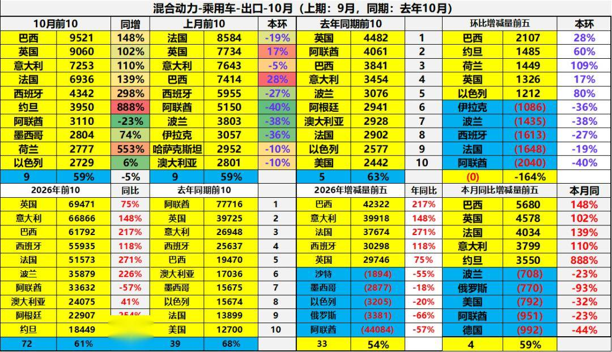

2026年10月出口乘用车普通混合动力的主要是巴西9521辆、英国9060辆、意大利7253辆、法国6936辆、西班牙4342辆、约旦3950辆、阿联酋3110辆、墨西哥2804辆、荷兰2777辆、以色列2729辆，其中本期较同期增量增大的前五个是：巴西5680辆、英国4578辆、法国4034辆、意大利3799辆、约旦3550辆。

2026年1-10月出口乘用车普通混合动力的主要是英国69471辆、意大利66866辆、巴西61792辆、西班牙55935辆、法国51573辆、波兰35879辆、阿联酋33632辆、澳大利亚24075辆、阿根廷22907辆、约旦18449辆，其中今年较去年同期增量增大的前五个是：巴西42322辆、意大利39918辆、法国37674辆、西班牙30298辆、英国29746辆。

五、货车分类别出口走势

1、货车出口

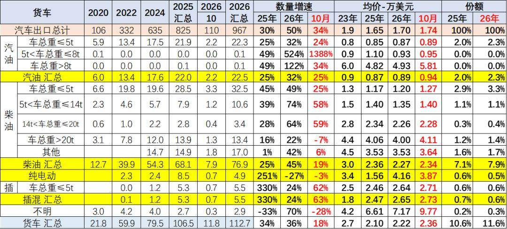

货车市场出口近几年增速不强，在汽车出口市场占比表现处于持续小幅萎缩状态，但2026年因纯电动和柴油轻卡表现较强，拉动出口占比改善。货车市场主力是5吨以下汽油和柴油货车较强，5-14吨和20吨以上柴油重卡货车总体来看也有较强需求。

2、货车出口市场变化特征

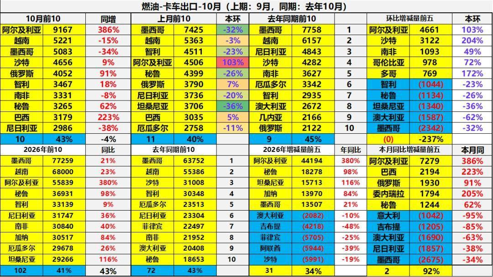

燃油货车出口市场：阿尔及利亚9167辆、越南5221辆、墨西哥5083辆、沙特4656辆、俄罗斯4052辆、智利3467辆、南非3331辆、秘鲁3265辆、巴西3179辆、尼日利亚2986辆，其中本期较同期增量增大的前五个是：阿尔及利亚7279辆、巴西2194辆、俄罗斯1930辆、委内瑞拉1794辆、秘鲁1244辆。

2026年1-10月燃油货车主力出口市场：墨西哥77259辆、越南68000辆、阿尔及利亚55839辆、秘鲁36931辆、智利33139辆、尼日利亚31747辆、南非30840辆、加纳30517辆、厄瓜多尔29678辆、坦桑尼亚29266辆，其中今年较去年同期增量增大的前五个是：阿尔及利亚44194辆、秘鲁18278辆、坦桑尼亚15713辆、加纳13970辆、墨西哥13507辆。

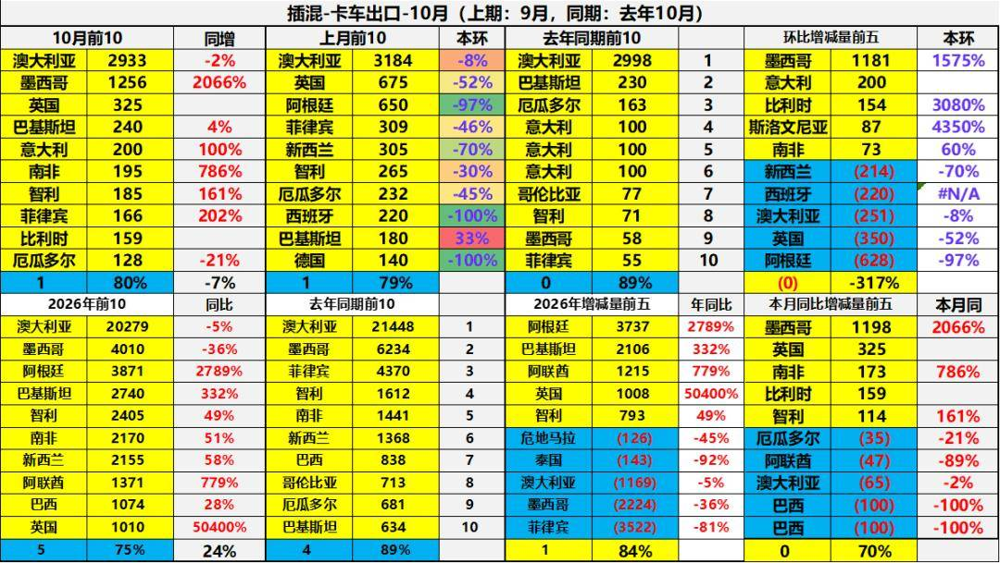

插混的货车出口市场近期较强，这主要是皮卡的乘用车属性的增量，在海外市场形成插混的野外场景便利和使用成本优势。

目前10月出口市场澳大利亚2933辆、墨西哥1256辆、英国325辆、巴基斯坦240辆、意大利200辆、南非195辆、智利185辆、菲律宾166辆、比利时159辆、厄瓜多尔128辆，其中本期较同期增量增大的前五个是：墨西哥1198辆、英国325辆、南非173辆、比利时159辆、智利114辆。

目前全年累计出口的前十是：澳大利亚20279辆、墨西哥4010辆、阿根廷3871辆、巴基斯坦2740辆、智利2405辆、南非2170辆、新西兰2155辆、阿联酋1371辆、巴西1074辆、英国1010辆，其中今年较去年同期增量增大的前五个是：阿根廷3737辆、巴基斯坦2106辆、阿联酋1215辆、英国1008辆、智利793辆。

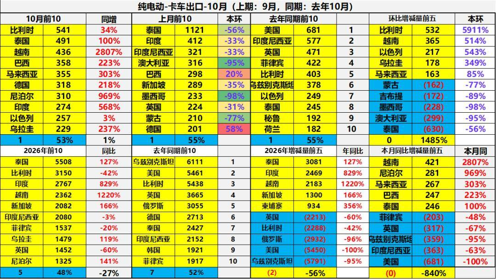

纯电动的货车出口市场近期暴增，这主要是特殊用车属性的暴增，在海外市场形成超强的场景便利和使用成本优势。

六、客车分类别出口走势

1、客车出口总体

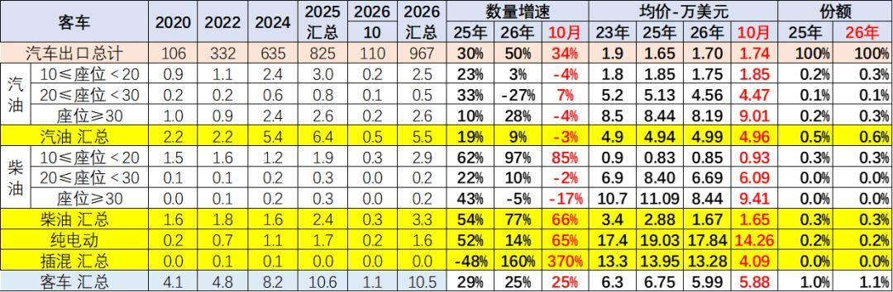

近期世界客车需求出现一定下降，导致前两年的中国客车出口持续萎缩，从2019年的6.4万辆下降到2022年的4.8万辆。2023年以来的世界需求恢复。

中国客车2025年的全年海关出口达到10.6万辆（同期厂家出口12.60万台），海关出口占比83%。2026年1-10月达到10.5万台（厂家出口15.2万台），海关出口占比69%。海外散件出口组装规模增大，乃至尼泊尔竟然是新能源客车出口的第一大国。

2026年1-10月纯电动客车出口1.6万辆，增14%的表现一般，柴油客车低基数出口增长较大，汽油大中型客车出口较强。

2、客车出口市场变化特征

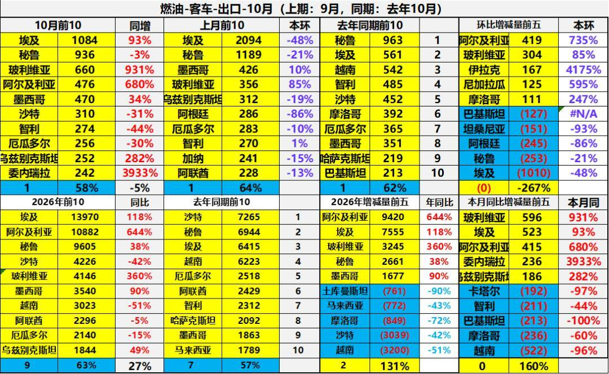

中国燃油客车出口主要市场比较分散，10月的前10位是：埃及1084辆、秘鲁936辆、玻利维亚660辆、阿尔及利亚476辆、墨西哥470辆、沙特310辆、智利274辆、厄瓜多尔256辆、乌兹别克斯坦252辆、委内瑞拉242辆，其中本期较同期增量增大的前五个是：玻利维亚596辆、埃及523辆、阿尔及利亚415辆、委内瑞拉236辆、乌兹别克斯坦186辆。

1-10月出口最多的是：埃及13970辆、阿尔及利亚10882辆、秘鲁9605辆、沙特4226辆、玻利维亚4146辆、墨西哥3540辆、越南3023辆、阿联酋2296辆、厄瓜多尔2140辆、乌兹别克斯坦1844辆，其中今年较去年同期增量增大的前五个是：阿尔及利亚9420辆、埃及7555辆、玻利维亚3245辆、秘鲁2661辆、墨西哥1677辆。客车出口属于欠发达国家为主，市场比较复杂，难以有序持续开展出口。

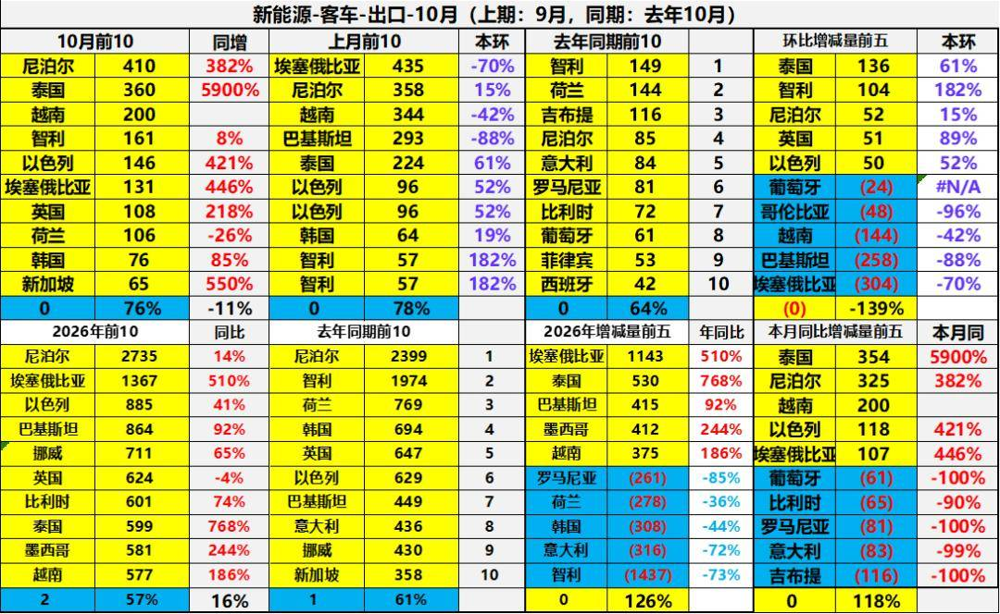

纯电动客车出口市场较小，数据波动较大，今年10月的出口主力是：尼泊尔410辆、泰国360辆、越南200辆、智利161辆、以色列146辆、埃塞俄比亚131辆、英国108辆、荷兰106辆、韩国76辆、新加坡65辆，其中本期较同期增量增大的前五个是：泰国354辆、尼泊尔325辆、越南200辆、以色列118辆、埃塞俄比亚107辆。

纯电动客车今年全年的出口主力是：尼泊尔2735辆、埃塞俄比亚1367辆、以色列885辆、巴基斯坦864辆、挪威711辆、英国624辆、比利时601辆、泰国599辆、墨西哥581辆、越南577辆，其中今年较去年同期增量增大的前五个是：埃塞俄比亚1143辆、泰国530辆、巴基斯坦415辆、墨西哥412辆、越南375辆。

附：近日信息合集
